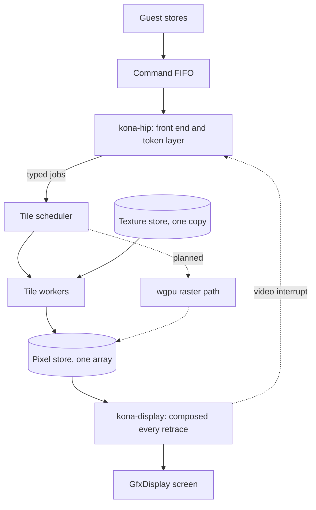
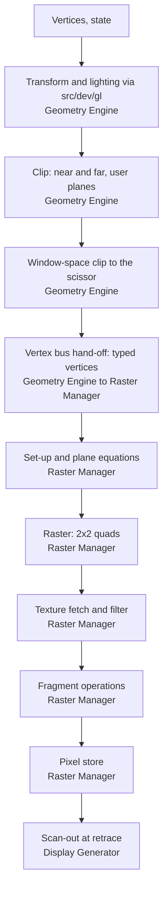

# Design: the InfiniteReality drawing back end

Status: 2026-11-07. Steps 0-3 are on `kona-back-0` to `kona-back-3`, stacked on
`kona-front`. Replaying the recorded PROM session gives a frame identical to
the capture, and the recorded IRIX window session replays up to a known
divergence. Steps 4-14 are not built. The plan is
[onyx2-infinitereality.md](onyx2-infinitereality.md).

`kona-front` has the command half of the board (`src/dev/kona/`). It answers
the commands about the board and hands everything that draws or changes
display state to a `Backend` trait. This is what implements that trait.
Nothing I hold gives hardware pixels, so the whole model is an approximation
and no test claims pixel accuracy.

## Shape

The stages, with the board each one stands in for:

The back end replaces everything behind the Host Interface Processor. The
paper and technical report describe the pipe as a geometry board, one to four
Raster Manager boards and a Display Generator. I model them like this:

- **Token layer.** Runs on the front end's thread, in stream order, as plain
  `&mut self` data. It tracks GL contexts and uses the shared GL core
  (`src/dev/gl/`) for transform, lighting, clipping and window mapping, the way
  VPro does: KONA implements `ClipVertex` for its own vertex type (or uses
  `Wv<8,1>`) and its own `Geometry`. Nothing in `src/dev/gl/`, MGRAS or VPro is
  edited. MGRAS's `gl.rs` is private and tied to the RE4's registers, so
  primitive assembly, cull, polygon modes, select and a window-space clip are
  KONA's own. The transform side is one plain `repr(C)` struct,
  valid zeroed, so a context copy is a `memcpy` and a snapshot chunk is that
  struct. It stands in for the geometry engines and the board controller's
  firmware. The X integer path expands into raster jobs that draw the pixels
  the request names. GL queries are answered natively after the raster queue
  drains, so a reply never overtakes drawing. Token layouts come from QEMU's
  KONA model (`hw/misc/sgi-kona-gl-decode.c`, `hw/misc/sgi-kona.c`).
- **Typed jobs, not bus words.** The token layer hands the raster stage typed
  vertices and state, as VPro's `GlDrawJob` does. State sits in one struct per
  functional group behind an `Arc`, snapshotted once per draw. I measure the
  typed struct against bus words before committing (step 5); that benchmark
  includes the `Arc` snapshot per group, with a fixed pool of group records
  as in VPro's `slot.rs` as the fallback, so the job type doesn't change.
  - **Clip, don't clamp.** Near and far are geometric clips against the six
    plane distances, z+-w included (inferred from the published
    InfiniteReality paper, Montrym et al., SIGGRAPH 1997); which exact z range
    is cut is unconfirmed. x and y clip only at a guard band, and the raster
    stage scissors the rest. The model stands in for that with a window-space
    clip of each polygon to the scissor before quantising, the way MGRAS clips
    with a signed window origin (approximated). Clamping to the 12.8 range would
    change slopes, so it stays only as a last-resort assertion.
  - **Texture floats.** Perspective-correct texturing is inferred (same
    paper): a fourth texture word per textured vertex carries the perspective
    term. Its form (1/w, q/w or 1/q) is unknown. I keep four floats, s/w, t/w,
    r/w and a fourth, linear in screen space, and untextured vertices carry no
    w. Colour is inferred linear in screen space; the textured-colour case is
    not fully excluded (ledger).
  - **One snap.** The token layer truncates toward minus infinity to the 1/256 grid once (the board's rounding
    is unknown), and
    set-up takes that value to 1/8 exactly, so there's no double rounding.
    The half-pixel GL offset is applied after clipping, when a vertex becomes a
    job, and is tested separately for unit squares, a one-pixel line and a
    point.
- **One pixel store.** The RMs split pixels in two-pixel strips, but a guest
  can't tell which RM holds a pixel, so I keep one array. It is plane-major:
  one `u32` array per word of the pixel record, allocated whole at draw set-up
  and published through a fixed `AtomicPtr` so workers and the display never
  check for allocation. Texture is one zero-allocated copy.
- **Rasteriser.** VPro's shape, with KONA's own records and scheduler: 2x2
  quads, plane equations evaluated at every pixel, integer or reproducible
  `f32` per pixel with `f64` only in set-up. Specialise with const generics and
  SIMD lanes. Not MGRAS's RSS, which models the RE4's edge walk, and no JIT
  unless a profile of step 7 or 8 shows branching in the fragment loop.
  `ops.rs` holds KONA's own compare, logic op, blend factor and stencil op;
  there is no shared fragment-state type, and deduplicating VPro's and MGRAS's
  copies is upstream's choice.
- **Screen tiles.** Square tiles, one owner each, as in
  [screen-tiles](../odyssey/screen-tiles.md). The raster stage queues each
  primitive on every tile it touches; a worker owns a ready tile until it is
  empty. Tiles scale with host cores and avoid the false sharing that
  per-RM strips would cause. KONA gets its own tile scheduler to these rules.
  VPro's ring and queues are tied to VPro's types and sit in upstream's hot
  path, so I don't factor them out or share them.
- **Display at retrace.** The display thread composes the whole frame at
  retrace from the pixel store and the display tables, every retrace with no
  change tracking, as VPro does, picking a kernel per
  run of equal display ID. Swaps and retrace requests carry a ticket and
  complete at a frame boundary.

Not modelled: per-RM ownership, raster-bus words, the raster register file
(raw writes are counted and logged) and flow-control credits.

Unexpected input is counted per kind, shown by the `kona` monitor commands and
logged. Nothing is answered with a made-up success.

## Threads

| Thread | Does |
|---|---|
| `kona-hip` | front end, token layer, replies, transfers, display-table writes |
| `kona-raster` | primitive set-up, tile binning, retiring slots in order |
| `kona-tile-N` | shades and stores the quads of the tiles it owns |
| `kona-display` | composes at retrace, latches swaps, drives the video interrupt |

Processors never touch the back end. The front end takes its pipe state out of
the `Shared::pipe` slot for `kona-hip`, so the token layer needs no lock and no
`UnsafeCell`. Only the pixel and texture stores, the display tables, the slot
ring and tile queues are shared. Anything that must see drawing drains the
raster queue first. The display waits for nothing, and a guest sync fault
shows as a flash of wrong pixels, as on the board. Set-up starts inline on
`kona-hip` and gets its own thread only if a profile asks. Worker count and
tile size are the existing `[graphics] threads` and `tile` settings.

## Ready for the GPU

I'm planning a wgpu raster path for KONA and not building it yet. It reuses the
batch, memory and scan-out layers in `src/wgpu`, with KONA's own records and
kernels. So the CPU path keeps three constraints:

- The per-pixel stage is integer or reproducible `f32`. `f64` appears only in
  set-up, because WGSL has no `f64`.
- `WordArray::store` is the single write point into the pixel store.
- Records at the raster boundary are flat: plain data with no pointers.

## Replay and benchmarks

I replay recordings from QEMU's KONA recorder (PROM and 4Dwm on a two-RM IR2).
The driver performs the recorded stores and loads, feeds the recorded DMA,
and checks the replies, geometry-engine interrupts and swap markers in order,
with a tolerance on read-back rows and the final frame. Recordings stay out of
git; the harness finds them by environment variable and skips when absent, so
upstream CI never runs it. Golden scenes follow VPro's: a small window per
scene, planes hashed, bit-exact by default. Those hashes are Iris's own, so
they catch regressions and time runs. They don't show correctness. Recordings
of the GL demos don't exist yet and step 9 needs them.

Benchmarks run with every function 64-byte aligned in both builds: fill rate
per scene at 1, 2 and 4 workers, token-layer vertices per second (typed
against bus words), a timed 4Dwm-plus-GL replay, and display frames per
second. A CPU-benchmark regression from the board's presence fails the PR.

## Steps

Each step is its own PR, tested on the test board. Stock-software claims wait
for step 14.

0. Skeleton: front-end additions, `KonaBackend`, monitor commands, replay
   driver and a census of the recordings. Test: both recordings replay into
   `NullBackend`.
1. Pixel store and layout. Test: layout case, pack round trips.
2. Textport and X integer path. Test: PROM replay hashes.
3. Display, tickets and the video interrupt. Test: PROM frame against capture.
4. X pixel path, memory regions, minimal context switch. Test: 4Dwm replay.
5. Token layer: GL state to a vertex list. Test: vertex goldens, hand-off
   benchmark.
6. KONA's tile scheduler: slot ring, per-tile queues, ready queue, work budget
   and job ring, written to the screen-tiles rules, plus the golden runner. No
   VPro code moves. Test: a command reaches every tile it touches, slots retire
   in order, output bit-exact with an inline run.
7. Raster stage and tile workers on that scheduler: set-up, fill rule, colour, depth, scissor,
   clears. Test: goldens, fill rate at 1, 2, 4 workers, and a unit test that
   the per-pixel module has no `f64`.
8. Fragment operations and primitive kinds. Test: goldens.
9. Textures. Test: bit-exact upload and read-back, GL replay, and that no
   host-to-board DMA path drains the workers (`TexelWrite` is an in-order
   raster job).
10. GL pixel operations and queries, with select and feedback as their own
    sub-step (they run geometry through the clipper and the output path; MGRAS
    has select and no feedback to copy). Test: query replies against
    recordings; select and feedback goldens.
11. Contexts: full save and restore. Test: two-context golden.
12. Completion and swap hardening. Test: a large GL replay with no pipe kill.
13. Snapshots through the chunk store. Test: save, restore, hash, save again.
14. Join the Onyx2 deskside. Test: PROM, `hinv`, 4Dwm, the GL demos.

## Approximations

Test classes: R is replay against QEMU's recording, U is a unit or golden test
of Iris against itself, S is a stock-software outcome (step 14), N is nothing
observes it.

| Item | Grade | Test |
|---|---|---|
| Native token layer in place of engines and controller firmware | approximated | R, S |
| Typed vertices, not bus words | approximated | U benchmark |
| Vertex snap to 1/8 pixel, exact integer edges, reproducible `f32` or integer interpolation | unknown | U goldens |
| Sample rule (left/bottom out, right/top in) and positions | approximated | U |
| Half-pixel GL offset, applied after clipping | approximated | U golden, plus lines and points |
| `Geometry` policy: near and far clipped geometrically (inferred), exact z range unconfirmed; window position truncates toward minus infinity (unknown) | inferred, unknown | U golden with a z-straddling triangle |
| One snap to 1/256, then exactly to 1/8; window-space clip standing in for guard band plus scissor, not clamp | approximated | U: an edge on a grid line, an off-screen primitive |
| Colour linear in screen space (textured case not fully excluded); the fourth texture word's form (1/w, q/w or 1/q) | inferred, form unknown | U goldens |
| Depth as an integer fraction | unknown | U |
| X shapes draw the pixels the request names | approximated | R |
| Fragment operation order, blend and dither arithmetic | unknown | U goldens |
| Lines, points, stipple, texture filtering, format rounding | unknown | U, S |
| Region save and restore in the model's encoding | inferred | U |
| One pixel store, one texture store, display ID in its own plane | unknown layout | U, N |
| Completion by drain, swap by ticket | approximated | R, S |
| Display composition order, 60 Hz default, gamma and colour map widths | unknown | U, S, N |
| No credit count | decided | S: a large GL stream never trips a pipe kill |
| IR3 renders as IR2; IR4 identity only | approximated | S |

## Open

The set-up arithmetic can only be settled by measuring hardware. The display-ID
mode byte's fields are unknown, so overlays and colour-index windows wait. I
don't know who names texture addresses (step 9 reads the recordings) or how
wide a managed area can be past `GfxDisplay`'s stride. A census of the recorded GL streams at
step 5 settles how many vertices fall outside the window and which
texture-coordinate token forms appear. Whether the transform struct or the
`Arc` groups is what a snapshot writes for each context is decided at step 11.
